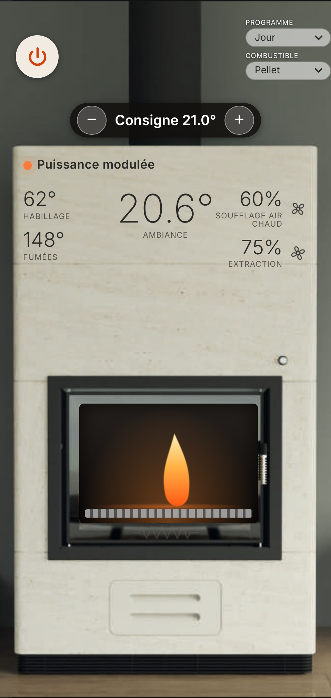
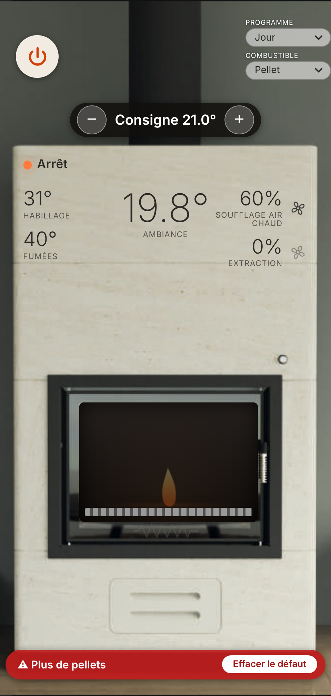

# Iwona Pellets pour Home Assistant

Intégration personnalisée pour les poêles/cheminées **Iwona Pellets** équipés du contrôleur **P.W. KEY RK-2014K/KW** (par exemple RK-2014KH), via le port **RS485 Modbus** du contrôleur et un convertisseur RS485 ⇄ WiFi/Ethernet comme l'**Elfin EW11**. Tout fonctionne en local, sans cloud.

> Projet communautaire non officiel, sans lien avec Iwona Pellets ni P.W. KEY. Utilisation à vos risques : un poêle est un appareil de chauffage. Lisez la section [Sécurité](#sécurité).

> **Statut (v0.12.1)** : testée sur un poêle réel (RK-2014KH, firmware C407) : lecture des états, marche/arrêt, consignes, combustible, écran et touches virtuelles. Les retours de test sont les bienvenus.

<p align="center">
  
  &nbsp;&nbsp;
  
</p>

<p align="center"><em>La carte animée « Cheminée » : en fonctionnement (à gauche) et avec un défaut et son bouton d'effacement (à droite).</em></p>

## Ce que vous obtenez

| Type | Entités |
|---|---|
| Capteurs | température chaudière, fumées, ambiante ; état du poêle (allumage, puissance maximale, extinction…) ; puissance des ventilateurs ; durée de fonctionnement du brûleur ; nombre d'allumages |
| Capteurs binaires | flamme, défaut (avec la liste des erreurs en attribut), sorties (vis, allumeur) |
| Interrupteur | **Start/Stop** du poêle |
| Nombres | consigne chaudière, consignes d'ambiance jour et nuit (bornes lues dans le contrôleur) |
| Sélecteurs | mode de programme (jour, nuit, arrêt, programmes 1 à 3) ; **mode de combustible** (pellet / bois / bois et pellet, désactivé par défaut, voir plus bas) |
| Boutons | effacer les erreurs, synchroniser l'horloge, touches virtuelles Menu/OK/+/− (désactivées par défaut) |
| Image | **Écran** du contrôleur (désactivée par défaut, voir plus bas) |

Les entités rarement utiles (eau chaude, ballon tampon, capteurs ambiants secondaires, entrées de sécurité…) sont créées **désactivées** : activez-les dans la fiche de l'appareil si votre installation les utilise.

## Langues

L'intégration (entités, options, services) et la carte sont disponibles en français, anglais, allemand, espagnol, italien, néerlandais et polonais ; la langue suit celle de Home Assistant (anglais par défaut). Pour ajouter une langue, copiez `translations/en.json` en `translations/<code>.json` et traduisez les textes.

## Matériel

- Un convertisseur RS485 ⇄ WiFi/Ethernet. Prévu pour l'**Elfin EW11** ; tout convertisseur capable d'exposer le port série en TCP convient.
- Du câble : une paire torsadée pour D+ / D-, plus la masse.

### Branchement

Sur le contrôleur, le bornier RS485 est **36 : GND, 37 : D-, 38 : D+, 39 : 12 V**.

| Contrôleur | Convertisseur |
|---|---|
| 37 (D-) | B |
| 38 (D+) | A |
| 36 (GND) | GND |

Les repères A/B ne sont pas normalisés d'un fabricant à l'autre : **si le convertisseur ne reçoit aucune réponse, inversez les deux fils**. Ne raccordez pas la borne 39 (12 V) sauf si vous savez que sa tension et son courant conviennent à l'alimentation de votre convertisseur.

### Réglages à faire correspondre

Dans le menu Modbus du contrôleur (voir sa notice), notez : l'**adresse esclave**, la **vitesse** et le **format de trame** (8N1, 8E1, 8O1 ou 8N2). Le constructeur recommande 115200 bauds. Le **niveau d'accès Modbus** doit être **USER** (lecture et réglages de base) ; n'utilisez pas SERVICE.

Sur l'Elfin EW11 : même vitesse, même nombre de bits, même parité et mêmes bits de stop que le poêle, mode **TCP Server**, port 8899, protocole **None** (transparent).

## Installation

### Avec HACS (dépôt personnalisé)

1. HACS → ⋮ → *Dépôts personnalisés* → ajoutez l'URL de ce dépôt, catégorie *Intégration*.
2. Installez *Iwona Pellets* et redémarrez Home Assistant.

### À la main

Copiez le dossier `custom_components/iwona_pellets` dans le dossier `config/custom_components/` de Home Assistant, puis redémarrez.

## Configuration

*Paramètres → Appareils et services → Ajouter une intégration → Iwona Pellets*.

| Champ | Valeur |
|---|---|
| Adresse IP | celle du convertisseur |
| Port TCP | 8899 (Elfin EW11 par défaut) |
| Adresse esclave Modbus | celle réglée dans le poêle (1 par défaut) |
| Mode du convertisseur | *Transparent* (trames RS485 brutes) ou *Passerelle Modbus TCP* |

Options (roue dentée de l'intégration) :

- **Intervalle d'interrogation** : 15 s par défaut (5 à 300 s).
- **Valeur écrite pour démarrer** : `1` (appui court, par défaut) ou `2` (appui long). C'est la valeur envoyée quand on met l'interrupteur *Start/Stop* sur marche. Sur le poêle testé, les deux valeurs donnent le même résultat (voir *Limites connues*).

## Sécurité

- L'intégration n'écrit que dans les registres de **réglages de base** (100 à 123) : marche/arrêt, consignes, mode de programme, mode saisonnier, effacement des erreurs, date et heure. Les seules exceptions sont le registre 10102 (mode de combustible) et le clavier virtuel 41512 (touches Menu/OK/+/−), dont les entités sont désactivées par défaut, avec les garde-fous décrits plus bas. Tout autre réglage installateur (au-delà du registre 123) est refusé par le code.
- Le contrôleur **ignore silencieusement** une écriture refusée (valeur hors limites, niveau d'accès trop bas) : l'intégration affiche alors une erreur « le contrôleur n'a pas acquitté l'écriture ».
- Le défaut « perte d'alimentation » du contrôleur inclut l'arrêt manuel : il apparaît dans la liste des erreurs, mais ne déclenche pas à lui seul le capteur *Défaut*.
- Testez la marche/arrêt poêle froid et sous surveillance avant de bâtir des automatisations. Ne comptez jamais sur cette intégration pour une fonction de sécurité.

## Diagnostic

- Capteur **Dernière erreur** : nom, date et heure de la dernière erreur du journal du poêle ; les 30 derniers événements sont dans ses attributs.
- Service `iwona_pellets.export_settings` : tous les réglages du poêle (valeur, minimum, maximum) par numéro de registre, en lecture seule. Le relevé complet d'un RK-2014KH est dans [`docs/REGISTRES.md`](docs/REGISTRES.md).

## Mode de combustible (pellet / bois / bois et pellet)

Le choix du combustible n'est pas dans la table de registres documentée. Il a été retrouvé en comparant des lectures du contrôleur faites dans chaque mode : c'est le réglage **10102** (0 = pellet, 1 = bois, 2 = bois et pellet).

L'entité **Mode de combustible** (liste déroulante) le lit en permanence. Elle est **désactivée par défaut** : l'activer revient à autoriser l'écriture d'un réglage qui n'est pas dans les registres de base, et le niveau d'accès Modbus du contrôleur doit le permettre. Garde-fous :

- elle n'écrit que dans le registre 10102, avec 0, 1 ou 2 ;
- passer de *bois* à *bois et pellet* (et inversement) est possible **poêle en marche**, comme avec la commande d'origine ; tout changement qui implique *pellet* exige que le poêle soit **à l'arrêt** ;
- l'état du poêle et le mode actuel sont relus juste avant l'écriture, puis le résultat est relu : si le contrôleur a ignoré la valeur (hors plage, accès refusé), une erreur claire s'affiche au lieu d'un faux succès.

Le contrôleur annonce pour ce réglage une plage de 1 à 2 alors qu'il vaut 0 en mode pellet : l'écriture de « pellet » pourrait donc être refusée sur certains contrôleurs. Les retours sont les bienvenus.

### Souffle / Ajouter du bois : non disponible

La fonction **Souffle / Ajouter du bois** (réglage 1.13 de l'afficheur, registre 10113) a été identifiée, mais le contrôleur **ignore toute écriture Modbus** sur ce registre, même en niveau d'accès SERVICE et menu ouvert. Il n'y a donc pas de bouton : la fonction reste utilisable depuis l'afficheur du poêle. Pendant qu'elle est active, l'état du poêle passe à *Ajout de bois (soufflage)*.

## Écran du contrôleur

L'entité **Écran** (image) reproduit l'afficheur du contrôleur (128×64 pixels, agrandi 4 fois), rafraîchi toutes les 10 secondes. Elle est **désactivée par défaut** (une lecture de 512 registres à chaque rafraîchissement) : activez-la dans la fiche de l'appareil, puis affichez-la avec une carte *Image* ou *Image entity* du tableau de bord. L'image est lue via la zone « terminal » du contrôleur.

### Touches virtuelles

Quatre boutons (**Touche Menu, OK, +, −**, désactivés par défaut) envoient la touche correspondante au contrôleur (registre 41512), comme si vous appuyiez sur le pupitre ; l'image de l'écran est rafraîchie juste après. Attention : ils agissent réellement sur les menus et réglages du poêle, vérifiez l'écran avant de valider. La touche code 2 (« Echap » dans la documentation) est en réalité la touche **Start/Stop** du pupitre : elle n'est volontairement pas exposée, utilisez l'interrupteur *Start/Stop*. Le fichier [`dashboard_card_ecran.yaml`](dashboard_card_ecran.yaml) donne une carte prête à coller (écran + touches) ; adaptez les identifiants d'entités.

## Carte animée « Cheminée » et fond d'écran

L'intégration embarque une carte Lovelace **`custom:iwona-stove-card`**, chargée automatiquement (aucune ressource à ajouter). Elle est construite uniquement avec les entités déjà fournies par l'intégration, donc **sans lecture de registre supplémentaire** : état du poêle, flamme animée (hauteur selon la température des fumées, de 20 à 300 °C ; une seule flamme centrale en mode pellet, toutes les flammes en mode bois et bois/pellet), ventilateurs qui tournent selon leur puissance, températures chaudière / fumées / ambiance, sorties (vis, allumeur), consigne d'ambiance avec − / +, Start/Stop, sélecteurs de programme et de combustible, bulle de défaut avec bouton « Effacer le défaut », résistance d'allumage qui rougeoie sous le foyer. Les entités sont détectées toutes seules ; au besoin, `entities: {room_temperature: sensor.xxx}` les remplace.

La carte prend la photo de la cheminée comme fond, avec les mesures et les commandes posées dessus ; la vitre du foyer est **remplacée par l'animation** (flamme proportionnelle à la puissance, vitre sombre à l'arrêt). Option `image:` pour utiliser une autre photo (le foyer est calé sur celle fournie). La photo est servie par l'intégration à l'adresse `/iwona_pellets/stove.jpg` et sert de fond au tableau de bord : voir [`dashboard_cheminee.yaml`](dashboard_cheminee.yaml) (vue de type *panel* avec `background`). Après une mise à jour de la carte, rechargez la page en vidant le cache (Ctrl+F5).

### Mise à l'heure automatique

Après une coupure de courant, l'horloge du contrôleur repart de 2014. À chaque lecture, si l'écart avec l'heure de Home Assistant dépasse 2 minutes, l'intégration réécrit la date et l'heure du contrôleur (registres 109 à 115 : année, mois, jour, jour de la semaine, heure, minute, seconde), au plus une fois par heure. Cette option est active par défaut et se désactive dans les options de l'intégration ; le bouton **Mettre à l'heure** force la synchronisation. Le jour de la semaine est envoyé avec lundi = 0 … dimanche = 6 : vérifiez-le sur l'afficheur après la première synchronisation (les programmes hebdomadaires en dépendent) et signalez tout décalage.

### Retrouver un autre réglage

Le contrôleur donne un accès en **lecture** à tous ses réglages « par numéro » (registres 10101 à 14999, bornes minimum en 15101 à 19999 et maximum en 20101 à 24999). Le service **`iwona_pellets.read_registers`** (Outils de développement → Actions, avec réponse) lit une plage sans rien écrire. Pour retrouver un réglage : faites une lecture, changez-le sur l'afficheur, refaites une lecture et comparez.

## Dépannage

| Symptôme | Piste |
|---|---|
| « Impossible de joindre le convertisseur » | IP/port, convertisseur en mode TCP Server, pare-feu |
| « Le convertisseur répond mais pas le poêle » | inverser A/B, adresse esclave, vitesse/parité/bits de stop identiques des deux côtés, niveau d'accès Modbus ≠ NONE |
| Valeurs de température ×10 ou ÷10 | ouvrez un ticket avec la valeur lue et celle affichée sur le poêle |
| Les valeurs sont toutes à 0 | mauvaise adresse esclave ou mauvais mode (transparent / Modbus TCP) |

Pour un ticket utile, joignez les journaux (`logger: custom_components.iwona_pellets: debug`) et la référence exacte du contrôleur (étiquette sur le boîtier).

## Développement

```bash
python -m pytest tests -q
```

Le client Modbus (`protocol.py`) et la table des registres (`registers.py`) n'ont aucune dépendance à Home Assistant et sont testés face à un faux poêle. Le dépôt contient aussi des workflows GitHub (hassfest, validation HACS, tests).

La table des registres provient de la documentation du constructeur, qui n'est **pas redistribuée** ici : demandez-la à Iwona Pellets si vous souhaitez la consulter.

## English summary

Local Home Assistant integration for Iwona Pellets stoves with the P.W. KEY RK-2014K/KW controller, over its RS485 Modbus port using an RS485-to-WiFi/Ethernet converter (e.g. Elfin EW11). Provides temperatures, process state, flame, errors, start/stop, setpoints and program mode. Modbus RTU over TCP (transparent mode) or Modbus TCP gateway mode. Only basic settings (registers 100–123) are written, plus the fuel mode (setting 10102), disabled by default and with safety checks. An optional image entity shows the controller's LCD. Install through HACS as a custom repository or copy `custom_components/iwona_pellets`. This is an unofficial project, use at your own risk.

## Licence

MIT, voir [LICENSE](LICENSE).

## Limites connues

- **Démarrage du bois avec allumage** : seul un appui long sur la touche Start/Stop *du pupitre* lance la séquence d'allumage (nettoyage → … → allumage). Depuis Home Assistant, l'écriture de 1 ou 2 dans le registre 102 et la touche Start/Stop virtuelle (maintenue, avec ou sans drapeau de répétition, plusieurs timings) donnent seulement l'état `work_wood` ou rien. La fonction a donc été retirée.
